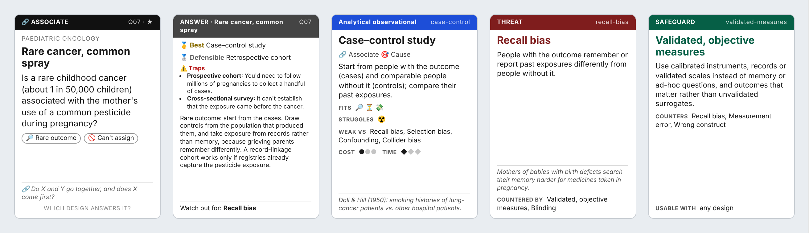

# Methodical

**A card game for scientists that teaches research methods.** Read a research problem, pick the method that can
actually answer it, then defend that method when a reviewer attacks it with a bias. The first game of the
**[SMART-Lab Science Game Kit](https://ua-smartlab.github.io/science-game-kit/)**, with
[Major Revisions](https://github.com/UA-SMARTLab/major-revisions-card-game) and [Red Flag](https://github.com/UA-SMARTLab/red-flag-card-game).



*One full chain:* a 🔗 **Associate** question with a rare outcome → **case–control study** (best) → its typical threat, **recall bias** →
countered by **validated, objective measures**, until a **Twist** changes the situation.

The cards are laid out like a trading-card game: name bar, attribute, level pips, one illustration, a type line and one sentence of effect text.
On the 60 Method cards the illustration is the study's own diagram, so the picture teaches the method. In the app, the **?** on every Method, Threat and Safeguard card opens the paper that defines it or made it standard.

## What's in the box

| Deck | Cards | Role |
|---|---:|---|
| Question | 74 | Research problems from medicine, ecology, astronomy, economics, engineering, robotics, chemistry, education… each with its own illustration |
| Method | 60 | Research methods and study designs in 9 colour-coded families, from case reports and capture–recapture to genome-wide association, process tracing and design science, each with a key reference |
| Threat | 29 | Biases and validity threats (the "fallacy" deck); the app adds a real historical example for each |
| Safeguard | 34 | Study-design and analysis features that counter specific threats (the "refutation" deck) |
| Twist | 17 | Mid-round changes: "The ethics board says no", "Funding cut", "Thirty studies just dropped" |
| Research Programme | 6 | Five-stage cooperative challenges on A6 mats, e.g. *Screens & teen mental health*, *A soft gripper for fruit picking* |
| Answer key | booklet | Three-tier answers and reasoning for every question and programme |
| Reference | 4 | Suits, constraints, families, scoring |

## Start here

- **Play online:** **[ua-smartlab.github.io/methodical-card-game/app](https://ua-smartlab.github.io/methodical-card-game/app/)**. Nothing to install.
- **Play offline:** open [`app/index.html`](app/index.html) in any browser.
  Its **Duel** mode (switched off for now: set `duel: true` in `FEATURES` in `app/template.html` to bring it back) pits you against a computer opponent (Student, Postdoc or Reviewer 2): both of you are dealt hands of Method and tactics cards,
  play methods face down onto four open questions, challenge each other's methods by naming a weakness and rebut by naming a Safeguard, and draft one of four
  face-up methods after every round. Highest score after 8 rounds wins.
  Or double-click the launcher for your system, which opens it in your default browser:

  | System | Launcher | Notes |
  |---|---|---|
  | Windows | [`play-windows.bat`](play-windows.bat) | Double-click in File Explorer. |
  | Mac | [`play-mac.command`](play-mac.command) | Double-click in Finder. If macOS blocks it, right-click it and choose **Open**. |
  | Ubuntu | [`play-ubuntu.sh`](play-ubuntu.sh) | In Files, right-click it and choose **Run as a Program**, or run `./play-ubuntu.sh`. |

  If a launcher won't run because its executable bit was lost (for example when it was unzipped), run `sh play-mac.command` or `sh play-ubuntu.sh`.
- **Print a prototype:** open [`print/cards.html`](print/cards.html) in Chrome and print at 100% on A4 with background graphics on, then cut. That gives 218 poker-size cards and 6 programme mats.
  All cards share one back ([`print/backs.html`](print/backs.html)); opaque card sleeves are the easiest alternative. The answers are in [`print/answer-key.html`](print/answer-key.html).
- **Rules:** [`RULES.md`](RULES.md) has four modes: *Methods Map* (classroom), *Peer Review* (competitive), *Research Programme* (cooperative) and *Reviewer 2* (drill).
- **Why it's built this way:** [`DESIGN.md`](DESIGN.md) covers the taxonomy, the learning goals, the answer-key philosophy and open questions.
- **Answer key:** [`ANSWER_KEY.md`](ANSWER_KEY.md) lists every question with its tiers and rationale.

## How it works in one paragraph

Every question has a **suit**, the kind of knowledge wanted (Describe, Explore, Associate, Cause, Predict, Measure,
Explain, Build, Synthesize), and **constraint** icons such as *can't assign*, *rare outcome*, *cutoff rule*, *one unit*
or *many studies*. Every Method card says which suits it serves and which constraints it fits or struggles with.
Constraints, not topics, decide between otherwise good methods, and learning to see that is the point of the game.
Answers are scored **best +3 / defensible +1 / trap −2**, and an unlisted answer can be **appealed** to the table,
because methodologists disagree.

## Editing the cards

All content lives in [`data/`](data) as JSON, one file per deck. After editing, run:

```sh
python3 tools/build.py
```

The script (standard library only) validates every cross-reference and regenerates the print sheets, the answer key
and the app. Card layout lives in `tools/cards.py`; the art is hand-built SVG in `tools/art*.py` (`art.py` holds the drawing kit
and the method diagrams). The build also checks that every method is the best answer somewhere, that every method's weakness has a usable
safeguard, and that each question's key threat is one its best method is actually weak to.

## Languages

The game is available in English, French, Dutch, German and Arabic. The app has a language picker, and each language has its own
app page and print deck: `app/<code>/` and `print/<code>/` (English is `app/` and `print/`). English is the source.
Card text is written in `data/*.json` and interface text in `i18n/en/ui.json`, and every other language is a translation of those.

```
i18n/
  languages.json   the languages: code, native name, text direction, optional extra font
  en/ui.json       interface and card-label strings by key (edit by hand); "art" translates labels drawn in the pictures
  en/cards.json    all card text by card id (generated by the build from data/; don't edit)
  fr/ui.json       the same keys, translated
  fr/cards.json    the same card ids, translated
  fr/GLOSSARY.md   the research-methods terms chosen for that language, with sources and open questions
  ...
```

### Adding a language

1. Add a line to `i18n/languages.json`, e.g. `{"code": "es", "name": "Español", "dir": "ltr"}`. For a script the default
   fonts don't cover, also give a Google Fonts family, as Arabic does: `"dir": "rtl", "font": "IBM Plex Sans Arabic"`.
2. Copy `i18n/en/ui.json` and `i18n/en/cards.json` into `i18n/es/`.
3. Translate the values. Never change keys, card ids or `{placeholders}`. Use the method names that researchers in that
   language already use, and keep card text about as short as the English, since cards are a fixed size.
4. Run `python3 tools/build.py`. It builds `app/es/` and `print/es/`, adds the language to every picker, and reports how
   much is translated. Anything left untranslated falls back to English, so a language can be added a little at a time.

When the English changes, the build regenerates `i18n/en/cards.json`; translators can diff it to see what to update.

The French, Dutch, German and Arabic translations were drafted and then reviewed term by term against each language's
authoritative sources (MeSH translations, Cochrane and national EBM glossaries, IQWiG, HAS, WHO EMRO, discipline usage).
Each `GLOSSARY.md` records those choices and ends with the questions a native-speaking methodologist should still settle.

## Status

Prototype v0.2: complete content in trading-card format, fully illustrated, printable, playable solo. The answer key has had one independent methodological
review pass, and its corrections are applied. Next steps are in [`DESIGN.md` §7](DESIGN.md#7-open-questions-and-next-steps),
starting with playtesting the Peer Review scoring and expert review per field.

## Licence

© 2026 Abdulhamid Baghdadi, SMART-Lab, Universiteit Antwerpen. Free for non-commercial use: teaching, study, research
and play. The cards, art and rules are under [CC BY-NC-SA 4.0](https://creativecommons.org/licenses/by-nc-sa/4.0/);
the software is under the [PolyForm Noncommercial License 1.0.0](https://polyformproject.org/licenses/noncommercial/1.0.0/).
Selling the game or making merchandise from it needs written permission. Details in [`LICENSE.md`](LICENSE.md).
